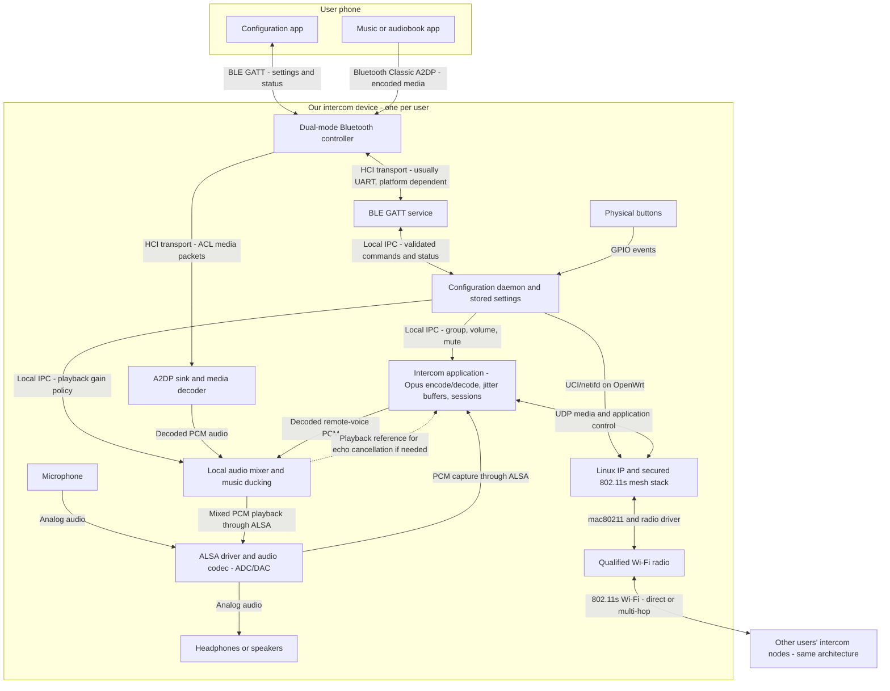

# Bluetooth + Wi-Fi Linux/OpenWrt platforms for the mesh intercom

Research date: October 31, 2026. Documentation and source-code review; no hardware combinations tested. This supplements [the original Linux/OpenWrt study](Linux-OpenWrt-integrated-platforms.md) and revises its shortlist because Bluetooth phone control is now mandatory.

## Requirements and conclusion

Target at least four independently operating nodes, overlapping speech, infrastructure-free 802.11s mesh, automatic reconnection, phone-based configuration over Bluetooth, and a path to a compact battery-powered product. Preserve an integration route for future 802.11ah/HaLow. **Bluetooth must support both phone configuration and reception of phone music/audiobooks while the Wi-Fi intercom continues operating.** For broad phone compatibility, use Bluetooth Classic A2DP sink for media and BLE GATT for configuration. A Bluetooth headset output link and phone-call HFP support are separate, currently unrequired features.

**Platforms combining Linux, Wi-Fi and Bluetooth exist. A small, current, turnkey OpenWrt module meeting every requirement has not been established by this research.** The strongest choices separate into three architectures:

1. **ARM Linux SoM with dual-mode Bluetooth + qualified mesh radio:** wireless CM4 is the leading prototype architecture for concurrent phone audio and mesh speech. Use its Bluetooth controller for phone media/control and a separate qualified radio for mesh.
2. **Compact OpenWrt mesh module + Classic Bluetooth audio solution:** Carambola 3/Lima preserves ath9k, but requires a dual-mode HCI controller with host audio software, or an A2DP receiver with a documented digital audio output and a separate configuration path. The previously proposed nRF52840 BLE module alone is insufficient. CPU and audio-interface limits remain gates.
3. **TI WL1837-based integrated Linux SoM:** CompuLab CL-SOM-iMX7, specifically the WAB wireless option. This combines an application processor with a documented mesh-capable Wi-Fi/Bluetooth radio. Linux support is documented; a ready-made OpenWrt image was not verified.

The AsiaRF AP7622-WH1 is a useful larger OpenWrt reference combining conventional Wi-Fi, Bluetooth and HaLow. Komikan is physically attractive but has significant software qualification concerns.

## Candidate comparison

Dimensions are module dimensions unless stated otherwise. Every final device also needs a carrier, power conversion/charging, antennas, controls, audio circuitry and an enclosure.

| Candidate | Integration and size | OpenWrt / 802.11s evidence | Assessment for our device |
|---|---|---|---|
| Carambola 3 or Lima + Raytac MDBT50Q-1MV2 | Existing 28 x 38 mm / 25 x 35 mm Linux/Wi-Fi module plus 10.5 x 15.5 x 2.05 mm BLE module | Existing ath9k/OpenWrt path; BLE application firmware and UART integration required | BLE control only: insufficient for phone music; replace/supplement Bluetooth hardware and requalify audio load |
| Wireless Raspberry Pi CM4 + separate radio | 55 x 40 mm SoM with Bluetooth/BLE; carrier-mounted PCIe mesh radio | OpenWrt platform support does not guarantee Bluetooth initialization or external radio functionality; qualify both | Preferred audio/application prototype; A2DP sink + BLE software needed; larger carrier and uncertain battery budget |
| CompuLab CL-SOM-iMX7 WAB, optional A audio | 42 x 68 x 5 mm SO-DIMM SoM; TI WL1837 onboard; optional analog codec | Linux/mainline/Yocto documented; TI documents 802.11s; OpenWrt board port not verified | Integrated candidate for Classic audio + BLE + mesh; concurrency and OpenWrt port remain unproven |
| TI WL1837MOD + chosen ARM host | 13.3 x 13.4 x 2 mm radio module, plus host/RAM/storage | Linux wl18xx; OpenWrt driver packages exist; explicit TI 802.11s documentation | Credible custom integration route; host bus mapping and board support are substantial work |
| 8devices Komikan | 21.3 x 37.5 mm LGA processor/RAM/flash/Wi-Fi/Bluetooth SoM | Vendor OpenWrt available; documented vendor baseline is old; 802.11s not established | Conditional only; integration alone does not justify selection |
| AsiaRF AP7622-WH1 | Approximately 120 x 160 mm router PCB, not a tiny SoM | Upstream OpenWrt board support; MT7622 Wi-Fi/BT plus MM610X HaLow hardware described | Useful bench reference, unsuitable final wearable footprint |

Sources for existing ath9k modules: [Carambola 3](https://www.8devices.com/products/carambola-3), [Lima](https://www.8devices.com/products/lima). BLE dimensions and interfaces: [Raytac module](https://www.raytac.com/product/ins.php?index_id=24). CM4 interfaces, wireless options and production horizon: [CM4 product brief](https://pip-assets.raspberrypi.com/categories/634-raspberry-pi-compute-module-4/documents/RP-008169-DS/cm4-product-brief).

## TI WL1837: the important additional radio option

TI explicitly lists 802.11s mesh for the active WL1837MOD, alongside dual-band Wi-Fi and Bluetooth/BLE. It connects to a Linux processor using SDIO for Wi-Fi and HCI UART for Bluetooth. It is a radio module, not a standalone Linux computer. Its host still needs RAM, storage, power and audio hardware. [TI product specifications](https://www.ti.com/product/WL1837MOD), [datasheet](https://www.ti.com/lit/ds/symlink/wl1837mod.pdf)

TI's mesh application note describes HWMP forwarding, secure peering through wpa_supplicant and multi-hop operation. It also identifies limitations, including no mesh power-save support in the documented implementation. Connected-idle radio current must therefore not be used as an estimate for a continuously receiving and forwarding intercom. [TI mesh application note SWAA166](https://www.ti.com/lit/an/swaa166/swaa166.pdf)

OpenWrt includes wl18xx/wlcore driver packaging, which makes this a credible OpenWrt component. That does not supply the chosen host's device tree, firmware provisioning, Bluetooth initialization or tested secure mesh configuration. Pin the exact kernel, driver, firmware and supplicant combination. The driver uses mac80211 but still depends on radio firmware; do not assume ath9k-equivalent control of the MAC. [OpenWrt wireless package definitions](https://github.com/openwrt/openwrt/blob/main/package/kernel/mac80211/Makefile)

Newer Wi-Fi/Bluetooth modules are not automatic replacements: explicit mesh support matters more than their Wi-Fi generation.

## CompuLab: integrated hardware, with an OpenWrt qualification gap

Order the **WAB** wireless option to obtain WL1837 and Bluetooth; the W option uses a different radio. The **A** option adds analog audio conversion. The module also exposes digital I2S, making it more directly suited to audio than Carambola/Lima. A carrier is required, but another application host is not. Vendor active-power figures span 0.5–3 W depending on configuration/load; these do not establish our complete-device consumption. [CompuLab specifications and ordering options](https://www.compulab.com/products/computer-on-modules/cl-som-imx7-freescale-i-mx-7-system-on-module/)

Treat it as a vendor-supported Linux/Yocto route unless an OpenWrt port is demonstrated. Visible BSP downloads include older releases: request the currently maintained kernel, wireless firmware, security maintenance policy and actual availability horizon. A historical “10-year availability” statement does not promise ten additional years from today. Do not transfer this radio assessment to the smaller UCM-iMX7, which uses a different wireless solution.

## Keep ath9k and add Bluetooth on the carrier (revised for phone audio)

Carambola 3 and Lima lack Bluetooth. The BLE-module design below covers configuration only and is insufficient by itself for the new phone-audio requirement. For music, select a Bluetooth Classic A2DP-capable solution with a host-accessible audio path; an analog-only receiver is less convenient for software mixing and echo cancellation. Raytac MDBT50Q-1MV2 contains an nRF52840 and an antenna; UART can connect it to the Linux module. Its antenna requires the manufacturer's placement and keep-out area. Match UART voltage levels and avoid pins needed for boot strapping or the debug console.

There are two distinct software arrangements:

- **BLE application on the MCU:** it exposes our GATT service and exchanges framed configuration/status messages with Linux over UART. Linux remains responsible for mesh and group configuration. This remains a configuration option, but needs an additional Classic audio solution if retained.
- **BLE controller for Linux:** suitable HCI firmware exposes the radio over UART/USB, and BlueZ on Linux implements GATT. This needs controller firmware, transport initialization and the corresponding OpenWrt drivers. A serial-command BLE module is not automatically an HCI controller.

Zephyr provides reusable Bluetooth application and HCI examples, but our command protocol, persistence, error handling and phone UI remain application work. [Zephyr Bluetooth architecture](https://docs.zephyrproject.org/latest/services/connectivity/bluetooth/bluetooth-arch.html), [peripheral service example](https://docs.zephyrproject.org/latest/samples/bluetooth/peripheral_nus/README.html), [HCI UART example](https://docs.zephyrproject.org/latest/samples/bluetooth/hci_uart_3wire/README.html)

The BLE MCU can optionally handle buttons, battery sensing and wake-up. It does not solve Linux audio CPU limits or make the Wi-Fi relay sleep through an ongoing conversation. Two 2.4 GHz radios also require coexistence testing during mesh traffic and BLE configuration.

## Raspberry Pi and radio selection

Choose a wireless CM4 for built-in Bluetooth/BLE, then add a qualified mesh radio over PCIe. An ath9k-based module is the conservative radio-control baseline; an AP-oriented mt76 module may offer newer hardware at higher power and software complexity. Check older ath9k module availability before designing it in. PCIe modules can be mounted on a custom carrier; they need not remain external adapters.

CM4 exposes I2S/PCM for an external codec, GPIO for buttons and additional host interfaces for expansion. Its published production horizon reaches at least January 2034. It still needs an audio driver configuration, power system and exact bus allocation. Under OpenWrt, built-in Bluetooth needs explicit firmware/transport integration; do not equate a booting CM4 image with a working BLE peripheral. Raspberry Pi OS/Linux is an alternative software baseline if OpenWrt integration becomes disproportionate. [CM4 brief](https://pip-assets.raspberrypi.com/categories/634-raspberry-pi-compute-module-4/documents/RP-008169-DS/cm4-product-brief), [OpenWrt Bluetooth driver configuration](https://github.com/openwrt/openwrt/blob/main/package/kernel/linux/modules/bluetooth.mk)

Pi Zero 2 W includes Bluetooth but lacks native PCIe, so it is less convenient for this radio architecture. An SDIO/SPI HaLow-oriented design could still use it after bus, driver and audio validation. CM5 offers more compute, but choose it only if measured audio processing requires the additional power/thermal budget. [Pi Zero documentation](https://www.raspberrypi.com/documentation/computers/zero.html), [CM5 brief](https://datasheets.raspberrypi.com/cm5/cm5-product-brief.pdf)

**Correction to broad mt76 recommendations:** mesh support varies by chip. The inspected MT792x code advertises station/AP/P2P modes, without mesh-point mode. MT7921/MT7922 combo Wi-Fi/Bluetooth cards should not be selected merely because they have Linux support. AP-oriented MT7615/MT7622 code does include mesh handling. Verify the intended driver's advertised modes and then test encrypted peering. [MT792x source](https://github.com/openwrt/mt76/blob/master/mt792x_core.c), [MT7615-family source](https://github.com/openwrt/mt76/blob/master/mt7615/main.c)

## Other integrated options and their limits

**Komikan** supplies Wi-Fi, Bluetooth, RAM, flash and a Linux CPU on one compact module. Its vendor wiki identifies a Linux 3.18.134 OpenWrt-derived baseline. Without a maintained BSP and demonstrated secure 802.11s, it is not the default recommendation. The vendor lists 6 W consumption, with insufficient workload detail for comparison against other candidates. [Komikan specifications](https://www.8devices.com/products/komikan), [software baseline](https://wiki.8devices.com/komikan)

**AP7622-WH1** has upstream OpenWrt board support describing both MT7622 Wi-Fi/Bluetooth and an AsiaRF MM610X-001 HaLow radio. This is useful evidence that the combination exists. It does not prove all three services work simultaneously in a stock image; HaLow firmware/packages and Bluetooth operation still need qualification. Its large router PCB is a bench platform. The 12 V / 1 A supply rating is not a measured 12 W consumption figure. [OpenWrt support commit](https://lists.infradead.org/pipermail/lede-commits/2025-September/027092.html), [AsiaRF product](https://asiarf.com/product/enterprise-lte-wi-fi-6-halow-lora-router/)

## Future HaLow integration

None of these ordinary 2.4/5 GHz radios becomes 802.11ah through a firmware update. Add a dedicated sub-GHz radio and antenna. Quectel FGH100M-H is a physically integrable SDIO/SPI module; qualify the regional SKU, exact firmware, board configuration/calibration data and host driver. [Quectel module brochure](https://quectel.com/content/uploads/2025/03/Quectel_Product_Brochure_V8.3.pdf)

Morse Micro's MM6108 OpenWrt evaluation-kit guide documents 802.11s configuration. Thus HaLow mesh has a concrete implementation path, rather than being only a future standards possibility. However, support does not automatically transfer to every Quectel board, driver release or newer MM8108 variant. Morse maintains its own OpenWrt tree; kernel/backport and firmware compatibility are integration tasks. [MM6108 evaluation-kit guide](https://www.morsemicro.com/download/mm6108-ekh01-evaluation-kit-user-guide/?wpdmdl=251203), [Morse OpenWrt source](https://github.com/MorseMicro/openwrt)

Reserve a usable SPI/SDIO controller, interrupt/reset signals, supply capacity and antenna space now. A shared boot-flash SPI bus is not automatically suitable. Document conflicts with storage, onboard Wi-Fi and audio pins before committing the carrier. An unused connector alone is not a HaLow upgrade strategy.

## Phone control and remaining software

For configuration, use **BLE GATT**, with the phone as central and the intercom as peripheral. In parallel, the phone acts as **A2DP source** and the intercom as **A2DP sink** for music. Select and test a controller/software combination supporting these roles concurrently. Pairing is the transport/ownership step; it does not create the configuration UI. We need a phone app and a device service for identity, battery/status, mesh credentials/channel, group membership and volume/mute controls. BlueZ provides Linux GATT infrastructure; MCU BLE stacks offer the alternative implementation. [BlueZ GATT manager](https://github.com/bluez/bluez/blob/master/doc/org.bluez.GattManager.rst), [OpenWrt BlueZ packages](https://github.com/openwrt/packages/blob/master/utils/bluez/Makefile)

Linux should own validated configuration and network changes. Use authenticated access, a physical enrollment action or device-specific credentials, acknowledged commands, persisted settings and rollback. Coordinate channel/key changes across the group so one phone operation does not strand nodes. Configure each device over BLE or relay management commands through the existing mesh. Voice must continue after the phone disconnects. Firmware update from the phone is a separate resumable update workflow.

Existing components supply BLE transport, 802.11s peering/forwarding, ALSA and codecs. We still build the phone UI, management protocol, group/session logic, media transport/mixing/jitter handling, coordinated reconfiguration and recovery behavior. 802.11s does not supply voice conferencing, and ordinary Wi-Fi contention does not provide deterministic TDMA.

## Simultaneous phone music and intercom: architecture

This is a proposed architecture, not a validated board design. The primary audio endpoint is a locally connected microphone and headphones/speakers. It does not require sending the mixed output to another Bluetooth headset.

### High-level block diagram

The Bluetooth controller is drawn once with two host software paths. It does not require two Bluetooth chips: a suitable dual-mode controller handles BLE and Classic connections, while Linux software implements the services. The diagram abstracts shared BlueZ/HCI plumbing. HCI transports carry control/data packets; decoded PCM is produced by the host audio stack, not directly by a generic HCI UART pin.

### What each part handles

| Part | Responsibility | Principal interface |
|---|---|---|
| Phone configuration app | Network/group setup, ownership, status, volume/mute commands | BLE GATT; not part of the voice forwarding path |
| Phone media app | Selects and plays music/audiobooks | Bluetooth Classic A2DP source; optional AVRCP for media controls |
| Bluetooth controller | Radio link, Bluetooth controller functions and coexistence | HCI UART/USB or board-specific transport to Linux; firmware/initialization required |
| Linux Bluetooth/audio services | BLE GATT peripheral, A2DP sink, media decoding and PCM delivery | BlueZ plus a compatible audio layer such as PipeWire/WirePlumber, or an ALSA-oriented Bluetooth audio implementation |
| Configuration daemon | Validates/persists settings, coordinates mesh changes and group state | Local IPC; UCI/netifd on OpenWrt; GPIO input events |
| Intercom application | Microphone processing, Opus, peer sessions, UDP transport, jitter buffering and remote-voice decoding | ALSA PCM, UDP/IP, local configuration IPC |
| Mixer | Combines received voices with local music; gain, clipping protection and music ducking | PCM streams and playback controls |
| Audio codec | Microphone ADC and playback DAC; analog electrical interface | Usually I2S/PCM to host plus I2C control, or internal USB audio |
| Mesh stack and radio | Encrypted peering, link selection and multi-hop forwarding | 802.11s over radio; PCIe/SDIO host bus depending on hardware |
| Other intercom nodes | Run their own audio/session processing and relay when needed | Wi-Fi mesh; each may have its own paired phone |

Linux supports A2DP sink through suitable Bluetooth/audio software; Bluetooth pairing alone does not install or configure that pipeline. OpenWrt image size, packages and service management must be specified. SBC is the baseline codec; optional phone codecs are not required for the initial architecture. [WirePlumber Bluetooth roles](https://pipewire.pages.freedesktop.org/wireplumber/daemon/configuration/bluetooth.html), [PulseAudio A2DP source/sink documentation](https://wiki.freedesktop.org/www/Software/PulseAudio/Documentation/User/Bluetooth/)

### Platform-specific physical interfaces

| Platform | Bluetooth path | Mesh-radio path | Audio path |
|---|---|---|---|
| Wireless CM4 + separate mesh radio | Onboard Bluetooth, host UART transport and matching firmware/driver setup | External qualified PCIe radio; onboard Wi-Fi is not the mesh baseline | External I2S codec + I2C control, or internal USB audio |
| CL-SOM-iMX7 WAB / WL1837-based host | WL1837 Bluetooth HCI over UART | WL1837 Wi-Fi over SDIO | Optional onboard analog codec (A option), or documented I2S codec integration |
| Carambola 3 / Lima | Add Classic-capable HCI module or an audio receiver with an accessible audio output; BLE-only nRF52840 does not suffice | Existing ath9k radio | Internal USB codec is the existing baseline; no documented exposed I2S on these modules. A receiver's I2S output cannot simply attach to ordinary GPIO |

TI documents Classic audio and Wi-Fi/Bluetooth coexistence for WL1837. Wireless CM4 has dual-mode Bluetooth hardware. These establish viable hardware paths, not proof of simultaneous A2DP, BLE and four-node mesh performance on a particular OpenWrt build. Nordic explicitly confirms nRF52840 cannot implement Classic A2DP. [TI capabilities](https://www.ti.com/product/WL1837MOD), [CM4 specifications](https://www.raspberrypi.com/products/compute-module-4/), [Nordic A2DP clarification](https://devzone.nordicsemi.com/f/nordic-q-a/96122/about-a2dp-demo)

### Audio policy and simultaneous-operation requirements

- Music stays local by default; it is not transmitted to other riders. Only the microphone/intercom stream enters the mesh encoder. With speakers or acoustic leakage, echo cancellation should use the actual mixed playback as its reference.
- Microphone capture and mesh transmission continue while music plays. Received voices mix into playback; lower music gain when speech is detected, then restore it smoothly. Avoid clipping when multiple people speak.
- The device handles different Bluetooth and codec audio clocks through buffering/resampling. Additional decode/mixing load must be included in CPU and latency measurements.
- Test concurrent A2DP reception, BLE configuration and forced multi-hop voice, including reconnects and weak RF. A combo radio's coexistence feature helps but does not guarantee uninterrupted audio. Separate radios still share spectrum and need antenna/layout testing.
- Phone calls/HFP and output to a separate Bluetooth headset are additional features with different routing/profile requirements; they are not assumed in this design.
- Future HaLow replaces or supplements the Wi-Fi radio/network path. The BLE configuration, A2DP media path and mixer can retain the same application interfaces, subject to driver and performance validation.

This new requirement favors **wireless CM4 + a qualified mesh radio** for the initial audio prototype and **WL1837-based Linux hardware** for an integrated alternative. The compact ath9k path remains possible, but its BLE-only proposal is no longer a complete solution.

## Power, mechanics and qualification plan

Compare complete devices under the same workload: Linux idle, four-node voice, forced two-hop forwarding, BLE connected/configuring, and degraded RF. Include codec/amplifier, regulator losses and radio transmit bursts. A router's supply rating, an SoM's generic active-power range and a BLE radio's instantaneous current are different quantities.

For scale only, a nominal 3.7 V 2000 mAh battery stores 7.4 Wh. Assuming 85% usable energy, 1 W average gives about 6.3 hours; 2 W gives 3.1 hours; 3 W gives 2.1 hours. These are arithmetic scenarios, not candidate runtime predictions.

Module footprint is not product footprint. Include connectors/module height, antenna keep-outs, battery volume, microphone isolation, speaker placement, body detuning and heat. Separate Wi-Fi/BLE modules may require more RF layout work; a combo radio's coexistence support is useful but still requires testing during continuous voice. A future sub-GHz antenna can materially affect enclosure design.

Recommended next steps:

1. Prototype four nodes with a consistent radio/software baseline. Prefer wireless CM4 plus a qualified mesh radio for concurrent music and intercom audio. Carambola/Lima remains conditional on a Classic audio integration plan and immediate CPU/audio benchmarking; a BLE-only MCU does not fulfill the requirement.
2. Request a current CompuLab WAB/A configuration and maintained BSP/lifecycle information. Promote it if a Linux rather than strict OpenWrt baseline is acceptable, or an OpenWrt port is demonstrated.
3. Prove simultaneous A2DP music, BLE phone provisioning and voice, secured four-node peering, forced multi-hop, overlapping speech, partition/merge, coordinated configuration recovery and acoustic latency.
4. Measure whole-device power and CPU margin before selecting batteries or enclosure dimensions. Pin exact hardware revisions and firmware versions.
5. Test one intended HaLow module/host combination early if HaLow is likely in the first product. Preserve the phone-control protocol so changing the mesh radio does not require redesigning the app.

There is no procurement-ready winner yet. The research supports an integrable architecture and narrows the hardware choices; it does not establish measured range, runtime or four-person audio performance.
